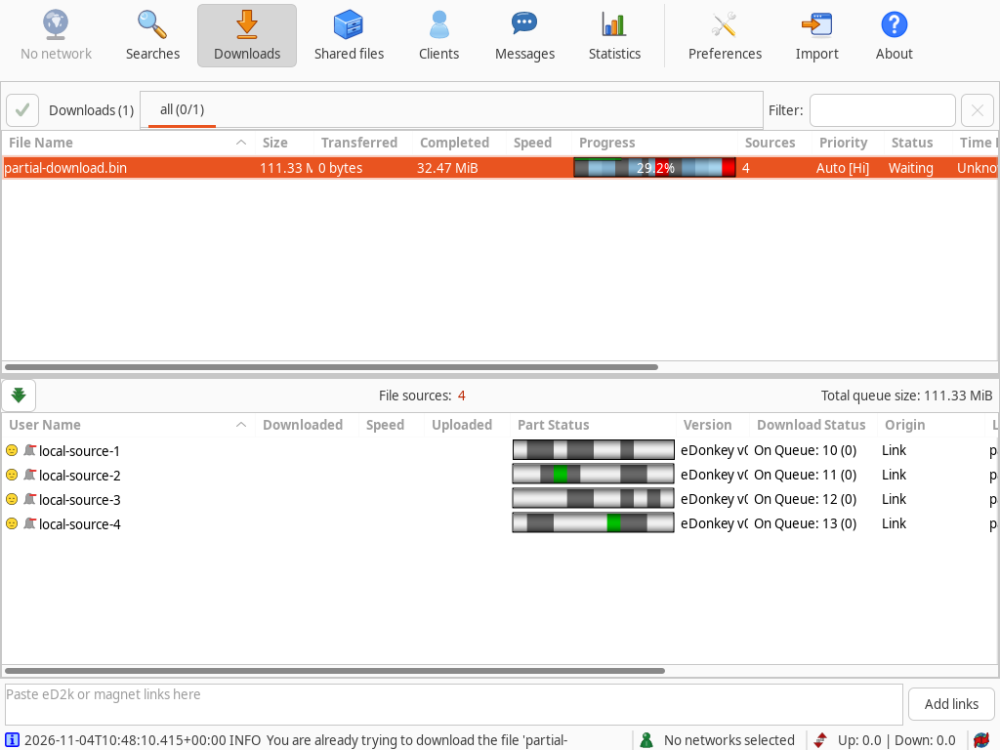

# PR #2347: progress and source part bars at four depths

These are native, full-window aMule wxGTK captures from the unmodified PR head
`3b5f3397adfe0c6889a267afb12ac20a764ce493`. Each run uses the same binary,
partial data and four local ED2K peer fixtures. Only the saved `eMule/3DDepth`
value changes: **0, 3, 4, 5**. Source and application code are not patched.

The 116,735,999-byte, twelve-part sample has 34,048,000 bytes completed (29.2%):
parts 0, 3 and 7 and half of part 5. The rest are gaps. The file is sparse and
its present data is zero-filled with matching MD4 part hashes. The four peers
advertise different part maps, then retain queue positions 10–13 without
transferring data. Missing part 11 is unavailable from every peer; other missing
parts have differing source frequencies. Thus both the download progress bar and
the individual source part bars exercise several colours. Transferred remains
zero because progress was seeded before launch, rather than transferred in this
session.

| Flat (0) | Rounded (3) |
| --- | --- |
|  |  |

| Rounded (4) | Rounded (5) |
| --- | --- |
|  |  |

The old saved/fallback value 10 is clamped to 5 by `CBarShader::Set3dDepth`.
Depth 3 and 4 provide softer rounded shading than 5. This evidence does not
select a replacement default; that remains a PR discussion.

Environment: Linux, wxGTK/wxWidgets 3.2.11, default GTK theme, Xvfb
1024×768×24, default display scale, English, no window manager. Captures are
unmodified full root windows. Native Windows/macOS and dark-theme appearance
were not exercised. Peers run on this host's non-loopback IPv4 address because
source discovery rejects 127/8; no public ED2K server or Kad network is joined.

## Reproduction

Build the source commit above:

```sh
cmake -S . -B build -DCMAKE_BUILD_TYPE=Release -DBUILD_MONOLITHIC=ON -DBUILD_REMOTEGUI=ON -DBUILD_ED2K=OFF -DENABLE_UPNP=OFF -DBUILD_TESTING=OFF
cmake --build build --target amule amulegui -j 8
python3 /path/to/capture.py /absolute/path/to/source /absolute/path/to/output
```

Requires Python 3, Xvfb, ImageMagick (`import`), libX11, libXtst and libcrypto
with MD4. The script imports the source checkout's existing integration helpers,
creates isolated offline profiles, selects the download through XTest, and
captures its real widgets. It verifies exactly 34,048,000 completed bytes,
all four peer handshakes and queue requests, preserved depth after shutdown and
clean application exit at every depth. `results.json` is written locally with
retained profile locations for inspection and is intentionally not published.
